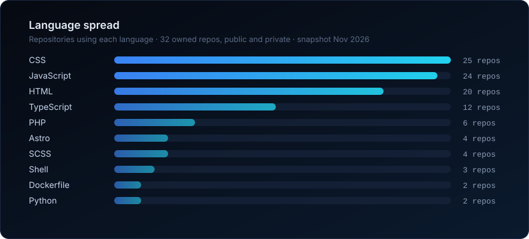

 

 

> *I build to understand. Most of what I know, I learned by shipping something, watching where it broke, and asking why.*

## About

I'm **Nitish Kumar**, a developer based in **Jaipur, India**, on GitHub since 2013. My work sits where **media, the web and automation** meet: news platforms that run themselves, AI pipelines that turn ideas into finished media, and small, careful systems at the edge that do one job well.

I think of myself in three registers:

| | |
|:--|:--|
| **Developer** — *by practice* | I ship real products end to end: data model, API, interface, deployment, and the dull operational parts that keep them alive. |
| **Thinker** — *by nature* | I care about *why* a system is shaped the way it is: trade-offs, failure modes, and what simplicity actually costs. |
| **Researcher** — *by curiosity* | I prototype to test ideas. If a new model, runtime or protocol looks promising, I'd rather build something small with it than read about it. |

## What I'm thinking about

- **Information at scale.** How news is gathered, ranked, summarised and found, and how much of that a machine should be trusted to do.
- **Search and discoverability.** Structured data, crawlability and how pages get understood by search engines and, increasingly, by AI answer engines.
- **Automation as leverage.** One developer with good pipelines can do work that used to need a whole team. I'm interested in where that breaks down.
- **The edge as a default.** Serverless runtimes and edge databases have changed what a small, cheap, globally fast app looks like.

## AI and emerging technology

I use large language models as **components, not magic**. They sit inside pipelines with clear inputs, outputs and fallbacks.

- **LLMs in production paths:** summarisation and key-takeaway extraction for news, script generation for short-form video, AI-assisted headline and SEO-title writing in Hindi and English.
- **Synthetic media pipelines:** text → neural voice (edge-TTS) → programmatic video composition (MoviePy) → automated publishing over the YouTube Data API.
- **AI-assisted engineering:** agentic coding tools as everyday collaborators, with review, tests and verification kept in the loop.

## Featured work

> Most of my repositories are private, so the source isn't linked. Live products are linked where they exist.

<table>
<tr>
<td width="50%" valign="top">

### NewsDog
**Real-time news aggregator with AI summaries**
 <a href="https://newsdog.online">newsdog.online</a>

A self-running news platform. Queue-based workers pull RSS feeds, categorise and de-duplicate stories, and produce AI summaries and quick-read digests. An admin console handles feeds, publishers, fetch logs and runtime tuning.

**Why it's interesting:** fetch intervals, concurrency, timeouts and retry policy are all tunable from the UI, and every fetch is logged with duration and errors. It's built to be operated, not just demoed.

`React 18` `Vite` `TypeScript` `Supabase` `PostgreSQL` `Docker` `Vercel`

</td>
<td width="50%" valign="top">

### Edge Central Auth
**Self-hosted single sign-on on Cloudflare Workers**

One credential store and session layer shared by 10+ applications. No third-party auth vendor and no early OIDC/SAML complexity.

**Why it's interesting:** salted PBKDF2-HMAC-SHA512 with constant-time comparison; session tokens stored only as SHA-256 hashes; per-IP and per-user rate limiting; server-side RBAC with per-app access control; a structured audit trail. Security fundamentals done carefully at the edge.

`Cloudflare Workers` `D1` `TypeScript` `Next.js` `jose`

</td>
</tr>
<tr>
<td width="50%" valign="top">

### AI Shorts Studio
**Automated short-form video production**

A pipeline that writes a script with an LLM, voices it with neural TTS, composes the video from stock footage, and publishes to YouTube. A web dashboard manages channels, prompts and the render queue.

**Why it's interesting:** a full creative workflow turned into a deterministic pipeline. It splits work between an edge-hosted control plane and a local Python render worker.

`Next.js` `Cloudflare Pages + D1` `Python` `MoviePy` `edge-tts` `YouTube Data API`

</td>
<td width="50%" valign="top">

### FoodKart
**Offline-first, multi-tenant POS for small food businesses**

A mobile-first billing and kitchen system for street-food stalls, chai kiosks and cloud kitchens: one-thumb checkout, UPI, thermal-receipt printing, kitchen display tickets and recipe-level inventory.

**Why it's interesting:** keeps working through internet outages (IndexedDB + background sync with idempotency keys) and keeps honest books, with an immutable double-entry stock ledger and true COGS/profit accounting.

`React` `Vite PWA` `Dexie / IndexedDB` `Cloudflare Workers + D1` `Zod`

</td>
</tr>
</table>

## Technology stack

*Only what I've actually shipped with, taken from my repositories.*

<table>
<tr><td><b>Languages</b></td><td></td></tr>
<tr><td><b>Frontend</b></td><td></td></tr>
<tr><td><b>Runtime &amp; data</b></td><td></td></tr>
<tr><td><b>Edge &amp; cloud</b></td><td></td></tr>
<tr><td><b>Ops</b></td><td></td></tr>
</table>

## GitHub in numbers

  

  

## Experiments and lab notes

Small builds that test an idea:

- **Hindi-first SEO tooling.** LLM-generated, search-aware headlines and titles for Hindi content, where most SEO tools are English-only.
- **Structured data at depth.** Rich-results-valid JSON-LD (`Product`, `AggregateOffer`, `FAQPage`, `BreadcrumbList`) on statically generated pages to see how far schema alone moves discoverability.
- **Edge-native everything.** Rebuilding classic server apps (auth, POS, CMS-style sites) on Workers + D1 to find where the edge is a better default and where it isn't.
- **Content migration by script.** Scraping and converting legacy sites into fast static Astro builds, with the content pipeline automated rather than copy-pasted.

## Writing and research

My writing so far lives in project documentation: architecture notes, deployment runbooks and design write-ups inside the repositories above. Public essays on **AI in news workflows**, **edge-first architecture** and **search in the age of answer engines** are in progress, and they'll be linked here when they're published.

## Connect

  

Build · Think · Research · Repeat

